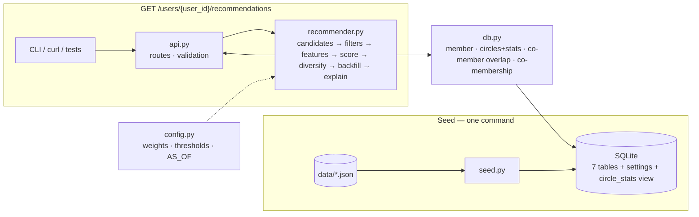
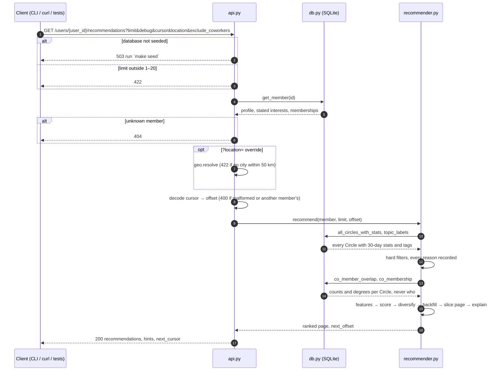

# System design

Companion to the one-page [`DESIGN.md`](../DESIGN.md): requirements, contract and shape of the service. The code matches this document; where the two disagree, the code and its tests are the truth.

## Functional requirements

| # | Requirement | Acceptance |
|---|---|---|
| FR1 | Given a unique `user_id` and a number `limit` (1–20, default 5), return the **top-`N`** Circles she is not a member of, ranked and deterministic | Every one of the 100 seeded members gets a full list; same request, same response; ties break on circle id |
| FR2 | Every result carries member-facing reasons and one explanation sentence, and obvious matches rank first | Reasons derive from the factors that produced the score; no internal vocabulary. [eg. User 7: her stated interests lead, and the Circles the brief names (#5, #6) appear] |
| FR3 | Never recommend a Circle that is full, unlisted, dormant, or already joined, or, when she asks, one with a coworker in it. Full or inactive Circles never outrank the healthy alternative. | A sweep over all members finds zero violations [eg. User 23: #22 first, #20 and #21 absent] |
| FR4 | Cold start: a member with no interests, memberships or profile still gets a sensible list | User 42 gets active, open Circles, one per topic, plus a hint |
| FR5 | Diversify: near-identical Circles on one topic do not fill the list | User 15: never all three of #10/#11/#12 in five results |
| FR6 | `debug=true` exposes the score breakdown and the excluded Circles with every applicable reason | Off by default |

Out of scope: authentication, write operations (join / request), real-time updates, admin tooling.

## Non-functional requirements

| Quality | Target | How it is met |
|---|---|---|
| Correctness | The four planted scenarios pass as property-based tests; the sweep passes for all members | `tests/` |
| Explainability | Every recommendation has at least one reason tied to a score factor; sentences pass a lint | `app/explain.py`, `tests/test_sweep.py` |
| Determinism | Same input, same output, independent of wall-clock time | `AS_OF` fixed to the dataset anchor; stable tie-break on circle id |
| Latency | Under 20 ms per request locally; a 200 ms budget at production scale | On-request scoring over the `circle_stats` view |
| Runnability | Fresh clone to running service in three commands; Python 3.10+; no external services | Pinned `requirements.txt`; the seed step creates the SQLite file |
| Maintainability | Weights, thresholds and `AS_OF` in one file; layered modules | `app/config.py`; `db / features / scoring / explain / api` |
| Privacy | Unlisted Circles are never exposed; other members appear only as counts | Hard filter; explainer templates |
| Fairness | Cold-start members get a full list; no Circle dominates every list | Rank-only scores, size band, one-per-topic sampler; exposure guardrail in tests |

## Core entities

| Entity | Role in ranking |
|---|---|
| Member (`users`) | the subject; location feeds same-city proof |
| TopicInterest (`user_topic_interests`) | stated interests, the primary signal |
| Topic (`topics`) | shared vocabulary; labels are what explanations print |
| Circle (`circles`) | the item: topic, availability, activity counters |
| CircleTag (`circle_tags`) | tie-break only |
| Membership (`memberships`) | exclusion, implicit interests, co-member social proof, co-membership tie-breaker |
| ActivityPost (`activity`) | comment and reaction depth for the activity score |
| CircleStats (view) | seats, fullness, size band, 30-day counts — what the ranker reads per Circle |
| Recommendation (response) | rank, circle summary, score, reasons, explanation |


## API Contract

#### 0. Infra/Observability endpoints: 
 `GET /health` (status, row counts, `as_of`)

 `GET /users/{user_id}` (the member as the ranker sees her; a profile, so behind auth in production).


#### 1. Core Function endpoint: 
`GET /users/{user_id}/recommendations?limit={limit}&debug={false}&cursor={next_cursor}&location={city|lon,lat}&exclude_coworkers={false}`

| Param | Type | Default | Notes |
|---|---|---|---|
| `user_id` | path, int | — | 404 if unknown |
| `limit` | query, int | 5 | 1–20, else 422 |
| `debug` | query, bool | false | adds `score_breakdown` per result and `excluded` on the response |
| `cursor` | query, str | — | `next_cursor` from the previous page; opaque, bound to the user; 400 if malformed or another member's |
| `exclude_coworkers` | query, bool | false | true: every Circle with a coworker in it is a hard filter (`coworkers` in `excluded`). false: coworkers are a 0.01 tie-breaker. Never shown in reasons. Pass it on every page; the cursor does not carry it. In production, a profile setting |
| `location` | query, str | her profile city | overrides the city the same-city signal uses, for this request only. `Seattle, WA` (case-insensitive) or `lon,lat`, snapped to the nearest known city within 50 km, else no city. 422 if coordinates are out of range |

`location` exists because a member's profile city is where she lives, not always where she is: a client with device location, or a member travelling, can ask for Circles that meet near her now. The dataset carries no coordinates, so `lon,lat` resolves through a static table of the ten member cities (`config.CITY_COORDS`); in production this is a geocoder or a city id. The override is not persisted. Pass the same `location` on every page of a paginated request; the cursor does not carry it.

Pagination is a slice of one ranked list, not a second ranking: the server ranks the top `offset + limit` and returns the tail, with ranks continuing across pages. This works because both the diversifier and the newcomer sampler are prefix-stable (pick *k* depends only on picks 1..*k*−1), and a sweep test holds every ranker to it. The cursor encodes the user id and the offset, so it cannot page another member's list. With at most 40 Circles the whole list fits in two pages; the mechanism is there for the 170k-Circle case, where a client scrolls rather than fetches.

#### Response fields: 
`user_id`, `strategy` (`stated_interests` · `implicit_interests` · `newcomer`), `as_of`, `location`, `exclude_coworkers`, `recommendations[]` (`rank`, `circle` summary, `score`, `reasons[]` of `{type, detail}`, `explanation`), `hints[]`, `next_cursor` (null on the last page). Reason types: `topic_match`, `implicit_interest`, `profile_interest`, `tag`, `led_interest` (off by default), `newcomer`, `fallback`, `same_industry`, `explore` (off by default), `active`, `shared_interests`, `same_city`, `open_spots`, `host_active` (off by default), `co_members` (a count only), `request_to_join`. 

A full example:
```
{
  "user_id": 1,
  "strategy": "stated_interests",
  "as_of": "2026-09-21",
  "location": "New York, NY",
  "exclude_coworkers": false,
  "recommendations": [
    {
      "rank": 1,
      "circle": {
        "id": 5,
        "name": "Women Who Lead",
        "topic": "leadership-skills",
        "format": "hybrid",
        "join_policy": "open",
        "member_count": 24,
        "max_members": 31,
        "seats_left": 7
      },
      "score": 0.5248,
      "reasons": [
        {
          "type": "implicit_interest",
          "detail": "You're in The Elevation Circle, another Leadership skills Circle"
        },
        {
          "type": "active",
          "detail": "11 posts this month"
        },
        {
          "type": "shared_interests",
          "detail": "1 member shares your interests"
        },
        {
          "type": "co_members",
          "detail": "17 members of your Circles are here too"
        }
      ],
      "explanation": "You're in The Elevation Circle, another Leadership skills Circle \u2014 11 posts this month and 1 member shares your interests."
    },
    {
      "rank": 2,
      "circle": {
        "id": 40,
        "name": "Network & Grow",
        "topic": "networking",
        "format": "hybrid",
        "join_policy": "open",
        "member_count": 12,
        "max_members": null,
        "seats_left": null
      },
      "score": 0.3961,
      "reasons": [
        {
          "type": "implicit_interest",
          "detail": "You're in The Network Effect, another Networking Circle"
        },
        {
          "type": "active",
          "detail": "4 posts this month"
        },
        {
          "type": "co_members",
          "detail": "10 members of your Circles are here too"
        }
      ],
      "explanation": "You're in The Network Effect, another Networking Circle \u2014 4 posts this month and 10 members of your Circles are here too."
    },
    {
      "rank": 3,
      "circle": {
        "id": 11,
        "name": "The Negotiation Table",
        "topic": "negotiation",
        "format": "hybrid",
        "join_policy": "open",
        "member_count": 15,
        "max_members": 25,
        "seats_left": 10
      },
      "score": 0.4613,
      "reasons": [
        {
          "type": "same_industry",
          "detail": "Not on your topics, but 2 members also work in Education"
        },
        {
          "type": "active",
          "detail": "13 posts this month"
        },
        {
          "type": "shared_interests",
          "detail": "1 member shares your interests"
        },
        {
          "type": "co_members",
          "detail": "11 members of your Circles are here too"
        }
      ],
      "explanation": "Not on your topics, but 2 members also work in Education \u2014 13 posts this month and 1 member shares your interests."
    },
    {
      "rank": 4,
      "circle": {
        "id": 22,
        "name": "Level Up Collective",
        "topic": "getting-promoted",
        "format": "hybrid",
        "join_policy": "request",
        "member_count": 14,
        "max_members": 20,
        "seats_left": 6
      },
      "score": 0.4464,
      "reasons": [
        {
          "type": "same_industry",
          "detail": "Not on your topics, but 2 members also work in Education"
        },
        {
          "type": "active",
          "detail": "8 posts this month"
        },
        {
          "type": "shared_interests",
          "detail": "2 members share your interests"
        },
        {
          "type": "co_members",
          "detail": "10 members of your Circles are here too"
        },
        {
          "type": "request_to_join",
          "detail": "You'll need to request to join"
        }
      ],
      "explanation": "Not on your topics, but 2 members also work in Education \u2014 8 posts this month and 2 members share your interests. You'll need to request to join."
    },
    {
      "rank": 5,
      "circle": {
        "id": 39,
        "name": "Mentorship Matters",
        "topic": "sponsorship-mentorship",
        "format": "virtual",
        "join_policy": "open",
        "member_count": 11,
        "max_members": 17,
        "seats_left": 6
      },
      "score": 0.3769,
      "reasons": [
        {
          "type": "same_industry",
          "detail": "Not on your topics, but 4 members also work in Education"
        },
        {
          "type": "active",
          "detail": "11 posts this month"
        },
        {
          "type": "open_spots",
          "detail": "6 open spots"
        },
        {
          "type": "co_members",
          "detail": "6 members of your Circles are here too"
        }
      ],
      "explanation": "Not on your topics, but 4 members also work in Education \u2014 11 posts this month and 6 open spots."
    }
  ],
  "hints": [],
  "next_cursor": "MTo1"
}
```


## Data flow

Seed once: `data/*.json` → `app/seed.py` → SQLite (seven tables, one settings row, the view).

Per request: load the member → pick the ladder rung → candidates = Circles minus joined → hard filters, every reason recorded → features from `circle_stats` and two aggregates over `memberships` (co-members who share her interests, city or industry; Circle counts of the people in her Circles, bounded) → topic from stated interests, else her Circles and her bio → weighted score → greedy pick with same-topic decay → fallback slots refilled in industry order → reasons from templates → response.

## High-level design



| Module | Owns | Does not know about |
|---|---|---|
| `api.py` | HTTP, validation, status codes, response models | scoring |
| `recommender.py` | pipeline order, ladder rung, newcomer sampler | SQL, HTTP |
| `features.py` / `scoring.py` | gates, feature functions, weighted sum, decay | HTTP |
| `explain.py` | reason templates from factor contributions | SQL |
| `db.py` + `schema.sql` | tables, view, indexes, queries | ranking |
| `config.py` | every number | everything else |

Request sequence: `api.py` → `db.get_member` → `recommender.recommend` → `db.all_circles_with_stats` + `db.co_member_overlap` + `db.co_membership` → pipeline in memory → JSON. Two reads (the member, every Circle with its stats) plus two aggregates over `memberships` per request; at scale both come from a precomputed store.



## Where each number acts

Every number in `config.py` does one of three things, at one of three steps. Everything ends up in the final order; only step 2 is the score every candidate is compared on.

**1. Filter (before scoring): the Circle is removed, nothing is weighed.** Already joined; full; `unlisted`; dormant (no posts in 30 days *and* quiet 90+ days); with `exclude_coworkers=true`, any Circle with a coworker in it. That filter is all company does.

**2. Score = Σ weight × feature**, every feature 0–1, the weights summing to 1.0.

| Weight | Factor | Feature value (0–1) | Adds to the score |
|---|---|---|---|
| 0.45 | topic | stated interest 1.0 · a Circle she belongs to 0.6 (0.4 beside stated) · her bio 0.3 (only when nothing is stated) · tag only 0.15 | 0–0.45 |
| 0.25 | activity | 0.7 × percentile of 30-day log-volume + 0.3 × recency (14-day half-life) | 0–0.25 |
| 0.20 | social | 0.7 × share of members sharing a stated interest (full at 50%) + 0.3 × same-city members (full at 3, in-person and hybrid only) | 0–0.20 |
| 0.05 | availability | open 1.0, request 0.7; +0.1 at 6–15 members, −0.1 above 20; capped to 0–1 | 0.03–0.05 |
| 0.05 | co-membership | people in her Circles who are in this one (2+), Adamic-Adar, full at 5.0 | 0–0.05 |

The bio (`TOPIC_PROFILE` 0.3) is not a weight: it is a value of the topic feature, multiplied by 0.45, so a bio match is worth 0.135 of the score.

**3. After scoring: a narrower comparison, never against all candidates.**

| Step | Number | What it is |
|---|---|---|
| Diversify | 0.7, 0.5 (`SAME_TOPIC_DECAY`) | multipliers on the 2nd and 3rd Circle picked on the same topic |
| Industry backfill | 0.10 (`INDUSTRY_BACKFILL_WEIGHT`) | a weight, but in a second, local comparison: only the Circles off her topics are ranked against each other on score + 0.10 × same-industry, and the slots they already held are refilled in that order (the refilled slot reports that score). A Circle on her topics never moves |

**Built, tested, shipped off.** Each is 0 in `config.py`; the `off:` rows of `make eval` switch it on with the value tried.

| Piece | Where it would act | Value tried | Constant |
|---|---|---|---|
| Hosted topic | topic feature: a Circle she leads on it | +0.2 (0.8 alone, 0.6 beside stated) | `TOPIC_LED_BONUS` |
| Active host | inside the activity feature: the leader posted in 30 days | +0.02 (0.005 of the score) | `ACTIVITY_HOST_BONUS` |
| Exploration | rank 5 swapped for an under-served, alive Circle; a probability, not a weight | 1.0 for cold-start members, or 0.2 for everyone | `EXPLORE_COLD_EPSILON`, `EXPLORE_EPSILON` |

**Newcomer** (nothing stated, no memberships, no bio) uses its own score, 0.6 × activity + 0.4 × availability + 0.10 × industry, then one Circle per topic with open Circles first; the filters still apply.

## What each piece costs and buys

`make eval` (or `python scripts/eval_loo.py [row ...]`) reports two kinds of number per configuration: leave-one-out accuracy (hide one of her memberships, see if it comes back in her top 5) and what the lists look like across all 100 members. "vs shipped" counts held-out memberships the row finds that shipped misses (+) and the reverse (−).

### Version comparison

The versions this submission went through, each re-run on today's code:

| Version | `make eval` row | hit@5 | MRR@5 | Most-shown Circle | Circles shown | vs shipped | p |
|---|---|---|---|---|---|---|---|
| First commit (`830c6a6`): the four factors, availability 0.10 | base four, avail 0.10 | 0.271 | 0.147 | #1, 52% | 34 | +9 −10 | 1.0 |
| + co-membership as a 0.02 tie-breaker | + co-membership 0.02, avail 0.10 | 0.273 | 0.148 | #1, 53% | 34 | +9 −9 | 1.0 |
| Tried: today's weights + leader signals + cold-start exploration | off: + leader, cold explore | 0.266 | 0.147 | #1, 46% | 35 | +5 −8 | 0.58 |
| Tried: shipped + exploration for one member in five | off: + explore 1 in 5 | 0.273 | 0.150 | #1, 49% | 35 | +1 −1 | 1.0 |
| Tried: shipped without the bio | no bio | 0.276 | 0.151 | #1, 51% | 34 | +2 −1 | 1.0 |
| **Shipped: today's weights + bio + industry** | + bio, industry (shipped) | **0.273** | **0.150** | #1, 50% | 34 | — | — |
| Baseline: five eligible Circles at random | random | 0.190 | 0.088 | — | — | +49 −81 | 0.01 |

The versions in between (company and host as their own tie-breakers, exploration for one in five at availability 0.10) used code that has since been folded in or removed, so they cannot be re-run; they scored inside the same band, 0.255–0.268.

**What p is.** A paired sign test (exact McNemar). Both versions are scored on the same 384 held-out memberships. Trials where both find the Circle, or both miss it, say nothing about which is better and are dropped; only the disagreements count. If the two versions were equally good, each disagreement would be a coin flip. p is the chance, under that coin flip, of a split at least as lopsided as the one observed, in either direction. The version tried just before shipping disagrees with shipped on 13 held-outs, 5 to 8: thirteen fair coins land at least 8–5 one way or the other 58% of the time, so p = 0.58 and the gap is ordinary noise. By the usual bar of p < 0.05, only random separates from shipped.

p is not the probability that one version is better, and a large p does not show two versions are equal: it says 384 synthetic held-outs cannot tell them apart. Separating versions a point or two apart would need roughly ten times as many held-outs, and real join labels rather than generated memberships.

**The decision.** No version beats another on accuracy, so shipped is the plain ranker with bio and industry: at the top of the accuracy band (a tie), deterministic, and every reason a member reads comes from a factor of her score. Leader signals and exploration stay built and tested, off until impressions, joins and real leader data can judge them. Exploration is the closest call: for cold-start members it would pull #1 from 50% to 46% of lists and bring one more Circle into view, and for one member in five it costs nothing measurable here; it is the first switch to turn on.

### Every row

| Row | What changes | hit@5 | MRR@5 | vs shipped | Most-shown Circle | Circles shown | Lists that differ from shipped |
|---|---|---|---|---|---|---|---|
| random | five eligible Circles at random | 0.190 | 0.088 | +49 −81 | — | — | — |
| topic only | topic factor alone | 0.266 | 0.136 | +17 −20 | #1, 47% | 33 | 98 |
| activity only | activity factor alone | 0.266 | 0.106 | +53 −56 | #3, 90% | 12 | 99 |
| base four, avail 0.10 | the four factors, availability at its old 0.10 | 0.271 | 0.147 | +9 −10 | #1, 52% | 34 | 75 |
| base four factors | the four factors, availability 0.05 | 0.266 | 0.147 | +7 −10 | #1, 49% | 34 | 69 |
| + co-membership 0.02, avail 0.10 | the 0.273 version: co-membership as a tie-breaker | 0.273 | 0.148 | +9 −9 | #1, 53% | 34 | 68 |
| + co-membership 0.02 | the same at availability 0.05 | 0.260 | 0.145 | +5 −10 | #1, 51% | 34 | 59 |
| + co-membership at 0.10 | co-membership as a larger factor | 0.263 | 0.145 | +8 −12 | #1, 52% | 34 | 66 |
| + co-membership | today's five weights | 0.263 | 0.148 | +3 −7 | #1, 52% | 34 | 37 |
| **+ bio, industry (shipped)** | profile fields | **0.273** | **0.150** | — | #1, 50% | 34 | 0 |
| no co-membership | shipped without it | 0.271 | 0.147 | +4 −5 | #1, 48% | 34 | 57 |
| no bio | shipped without it | 0.276 | 0.151 | +2 −1 | #1, 51% | 34 | 7 |
| no industry backfill | shipped without it | 0.260 | 0.148 | +1 −6 | #1, 51% | 34 | 33 |
| off: + leader signals | hosted topic +0.2, active host +0.02 | 0.271 | 0.148 | +1 −2 | #1, 50% | 34 | 29 |
| off: + leader, cold explore | the version tried before shipping | 0.266 | 0.147 | +5 −8 | #1, 46% | 35 | 48 |
| off: + cold-start explore | rank 5 for every cold-start member | 0.268 | 0.149 | +4 −6 | #1, 46% | 35 | 30 |
| off: + explore 1 in 5 | rank 5 for one member in five | 0.273 | 0.150 | +1 −1 | #1, 49% | 35 | 17 |
| alt: shipped, avail 0.10 | availability back at 0.10 | 0.271 | 0.149 | +4 −5 | #1, 51% | 34 | 38 |
| alt: co-membership 0.02 | co-membership back to a tie-breaker | 0.266 | 0.146 | +2 −5 | #1, 51% | 34 | 41 |
| alt: social 0.15, co 0.05 | 0.05 out of social | 0.273 | 0.151 | +2 −2 | #1, 48% | 34 | 32 |

How to read it:

- **Accuracy cannot rank these rows.** One standard error at n = 384 is about 0.022, and every row past random sits inside it; paired against shipped, only random separates. The harness is a guardrail against a large drop, and its labels are topic-biased memberships, so it cannot see health, joinability, explanations, profile fields or hosting. The decisions rest on the other columns.
- **Same accuracy, different product.** Topic only and activity only both score 0.266, but activity only shows 12 Circles and puts #3 in 90% of lists. hit@5 alone would not catch a popularity collapse; the exposure columns do.
- **Availability at 0.05, not 0.10.** Full Circles are already a hard filter and request-to-join is already in the reason, so the weight was only buying open-over-request and the size band. hit@5 flips with context (base 0.271 → 0.266, shipped 0.271 → 0.273), so it is not the reason; on the base, #1 drops from 52% to 49% of lists, and the more personal details ("2 members share your interests") reach the sentences in place of "no member cap".
- **Co-membership stays small.** It leans toward popularity (removing it moves #1 from 50% to 48% of lists; at 0.10 it reshuffled 76 of 100 lists against the base), and hit@5 cannot tell 0, 0.02, 0.05 and 0.10 apart. Social and co-membership are not substitutes (correlation 0.03), which is why moving 0.05 from one to the other changes lists but not accuracy.
- **Profile, leader and exploration pieces.** Seed profiles, leaders and post authors are random against memberships (`generate.mjs:201-204`, `:272`, `:343`), so each moves hit@5 by a hit or two either way. What bio and industry buy is outside the harness: reasons for members who stated nothing, and a better pick among fallbacks without moving a topic match. Leader signals add nothing measurable here. Exploration buys coverage and pulls #1 down, which is why it is the first switch to turn on.

## Tradeoffs and tech choices

Each row says what was given up and what would make it the wrong call.

**Ranking**

| Decision | Chose | Over | Why | Cost, and when to revisit |
|---|---|---|---|---|
| Model | Weighted heuristic, every number in `config.py` | Learned ranker (LTR, or a GNN over the member–Circle graph) | No join / decline labels exist; leave-one-out puts it at parity with topic-only (0.273 vs 0.266, p = 0.74). The graph signal was tried directly: co-membership, the neighbour aggregation a GNN would learn, at 0.10 reshuffled 76 of 100 lists toward #1 with no accuracy gain | Weights are estimates. Once a feedback log exists: offline eval, A/B, then a gradient-boosted ranker over today's features plus a graph-embedding similarity (a GNN as a feature, not the ranker), which keeps per-feature attributions for the reason templates |
| Unjoinable Circles | Hard filters: full, unlisted, dormant | Soft demotion | She cannot join a full Circle; an unlisted one is not meant to be found | A Circle one seat from full ranks normally; re-check seats at join time |
| Duplicates | Same-topic decay 0.7, then 0.5 | One Circle per topic | A second Circle on a stated interest stays competitive with off-topic ones | Near-duplicates are judged by topic alone; name and description similarity would catch more |
| Popular Circles | Exposure bound in a test | Hand-set penalty on #1 | A penalty is tuning toward a named Circle | #1 appears in half of all lists; exploration is built but off (next row), exposure caps are production work |
| Exploration | Built, tested, off: a deterministic epsilon-greedy slot at rank 5 (seeded by member and ISO week of `AS_OF`; alive Circles that are new, topic-less or in the quieter half), tried for cold-start members and for one in five | On now, or Thompson sampling | Without impression and join logs a bandit's posterior never updates. On for cold-start members it pulled #1 from 50% to 46% of lists for two held-out hits (p = 0.75); within noise either way, so the shipped list is the plain ranker | The first switch to turn on (`EXPLORE_COLD_EPSILON`, `EXPLORE_EPSILON`); with a log, Thompson sampling over join rate |
| Social proof | Shared interest, same city | Same industry or company as a boost | Similarity already structures networks (homophily); peer groups work across industries | Drops a "people like me" signal on topic matches; industry comes back as backfill only and company as her choice (next rows) |
| Industry | Backfill: refill the slots that went to Circles off her topics, in industry order | A weighted feature | As a weight, even 0.02 pushed 3 picks on members' implicit topics out of their top 5; refilling slots moves none | Scores can read out of rank order in a refilled slot; ranks are the order |
| Company | A filter only, her choice: `exclude_coworkers=true` drops every Circle with a coworker | A boost or tie-breaker | Coworkers can dampen candor, and some members want them anyway; as a 0.01 tie-breaker it moved 6 lists and nothing else; a shown count would tell her who from her company is in, say, a working-mothers Circle | By default company plays no part; a per-topic default (negotiation, promotion) is the next step |
| Bio | Keyword list per topic, read only when she stated no interests, at 0.3 | Always on, or embeddings | Stated interests must lead (obvious matches); keywords are testable and need no model | Misses paraphrase. Leave-one-out cannot reward it (seed bios are random against memberships); `make eval` has a `no bio` row |
| Availability | 0.05 | 0.10 | Full Circles are already a hard filter and request-to-join is already in the reason; what is left is open-over-request and the size band | Request-to-join Circles take slightly more of the picks (34% → 36%); newcomer lists keep open-first |
| Co-membership | A small ranking factor, 0.05 (the weights sum to 1.0) | A 0.02 tie-breaker, or 0.10 | Above the 0.030 median gap between neighbouring ranks, so it reorders more than near-ties; it leans toward popularity, so it stays small | hit@5 cannot tell 0, 0.02, 0.05 and 0.10 apart; removing it moves #1 from 50% to 48% of lists |
| Leader | Built, tested, off: a hosted topic +0.2, an active host +0.02 inside activity | On | Hosting says more than joining, and a Circle whose host went quiet tends to fold, but the seed draws leaders and post authors at random, so here both are noise (on: 0.271, p = 1.0) | Switch on (`TOPIC_LED_BONUS`, `ACTIVITY_HOST_BONUS`) once leader data is real. "The leader of your Circle hosts this one" would name a person, so it is not used |
| Co-membership cost | Request-time bounds: her 20 most recent Circles, 50 most recent co-members each, co-members in more than 30 Circles dropped | Unbounded, or precomputed only | A member in 100,000 Circles or a Circle with 100,000 members would otherwise pull every membership of every co-member; none of the bounds binds on the seed | Worst case 30,000 rows per request; at scale, precomputed Circle-to-Circle neighbours make it 20 × top-k |
| Cold start | Newcomer sampler: open, active, one per topic | Most popular | Popularity bias over-serves head Circles | Nothing personal until she adds interests, and the response says so in `hints` |

**Engineering**

| Decision | Chose | Over | Why | Cost, and when to revisit |
|---|---|---|---|---|
| Store | SQLite, portable SQL | Postgres | One file and `make seed`; nothing for a reviewer to install | Single writer, no partial indexes; the queries run unchanged on Postgres |
| Circle health | `circle_stats` view | Precomputed table | Always consistent with the data; cheap at 40 Circles | Recomputed per request; at scale a scheduled job writes it |
| Candidates | Score every Circle | Retrieval, then ranking | 40 Circles | At 170k Circles, candidates come from topic and geo indexes first |
| API | FastAPI + Pydantic | Flask | 422 validation and `/docs` for free | A heavier dependency set |
| Data access | Plain SQL in `db.py`, dicts out | ORM | Every query, and the index behind it, is visible | Hand-written row mapping |
| Pagination | Cursor = base64url(`user_id:offset`) over one prefix-stable list | Keyset cursor or a cached list | Correct because pick *k* depends only on picks 1..*k*−1 | Each page re-ranks from scratch, and a page can shift if the data changes between requests |
| Explanations | Templates plus a lint test | LLM-written sentences | Deterministic, testable, no invented numbers | Less natural; one template per reason type |
| Time | `AS_OF` anchor date | Wall clock | Same request, same answer | Production must advance `as_of` |

## Production shape

Same pipeline, four changes: candidates come from a topic + geo index instead of a scan; `circle_stats` is precomputed by a scheduled job instead of a view; the same job writes each Circle's top-k co-membership neighbours, so a request reads 20 × k rows instead of walking memberships; a feedback log (impressions, join / decline / leave) exists, so the heuristic can be evaluated offline, A/B tested, and eventually replaced by a learned ranker, and the built exploration slot is switched on as Thompson sampling over each Circle's join rate. Exposure caps and light exploration keep the most active uncapped Circle from appearing in half of all lists, which it does today.
